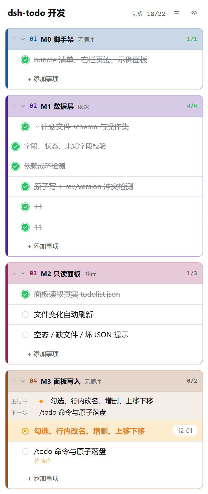
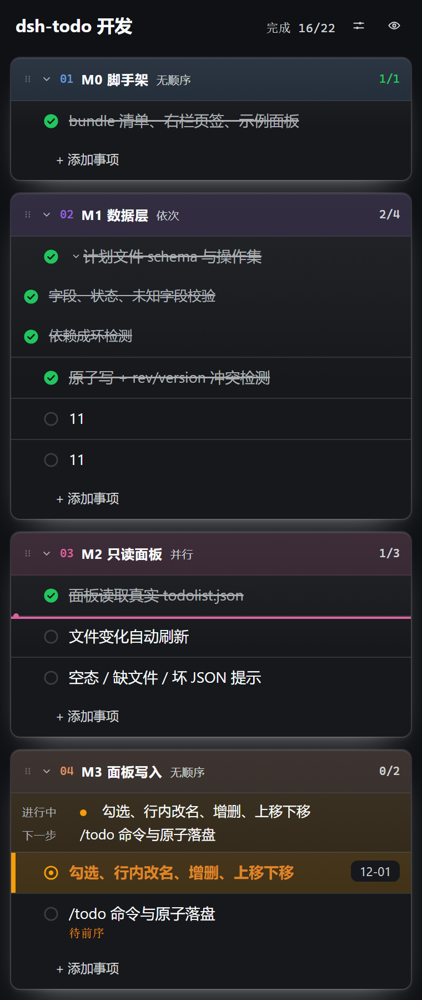
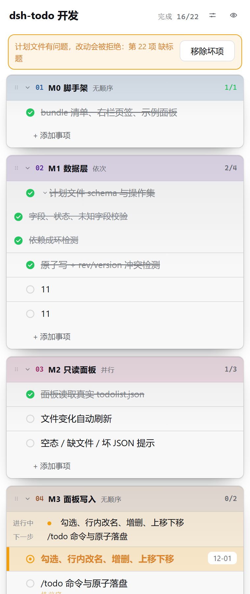
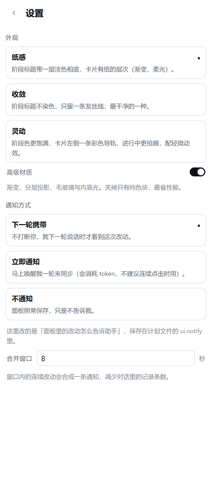

# dsh-todo

A project plan panel for [DeepSeek Harness](https://github.com/deepseek-ai/deepseek-harness) (DSH): a right-sidebar tab that tracks cross-session work by stage, with dependencies and due dates.



## Why another todo list

DSH's built-in todo strip sits above the composer, belongs to the current session, and is a flat list. That is not enough for work that spans days and sessions:

- **Stages**, ordered within themselves, possibly parallel;
- **Sub-items**, with the parent showing progress;
- **Dependencies**: "don't start this before that";
- **Due dates** that only show what you entered — the plugin never estimates effort;
- You edit **in the panel** and the agent learns about it; the agent edits **in the conversation** and you see it immediately.

## Division of labour

The panel owns exactly one bit per row; everything about "what is being worked on" belongs to the agent:

| Who | Can change |
|---|---|
| You (panel) | Done / not done (click the circle); add, rename, delete, drag to reorder, set a due date |
| Agent (`todolist` tool) | Mark **in progress** (several at once), set the **next** step (single pointer), and every other write |

To say "I'm working on X" or "X is next", just tell the agent — it is already listening.

## Features

- **Stage cards**, one hue each, with the current/next line always under the title; foldable with animated height; draggable as a whole.
- **Sub-items** fold behind a triangle on the parent (`+N` when folded); the folded state persists locally.
- **Drag to reorder** from the six-dot handle only. Hovering a row draws an insertion line, hovering empty space draws an "append here" line; releasing opens a confirmation bar at the bottom of the panel that reverts after 6 seconds; once confirmed, the other rows slide into place instead of jumping.

  

- **Due dates** appear only when you set them; overdue and today are coloured; clicking the chip clears it.
- **Hide completed** from the eye icon.
- **Broken-file recovery**: if one row in the plan file is invalid (common after hand editing), the panel names it and offers "drop the broken rows" instead of silently refusing every edit.

  

- **Notifying the agent**: panel edits reach the agent in one of three modes — `next turn` (default, no interruption), `wake now`, or `do not notify`. Bursts merge into one notice within a window (8 seconds by default, configurable).
- **Four looks**: `vivid` (default — coloured header, a 4px rail down each card, a matching outline), `md3` (Material Design 3: tonal containers, pill badges, white rounded row cards), `paper` (hued header with a paper-like grain), and `calm` (no hue, one hairline). Advanced materials (gradients, layered shadows, frosted glass) have their own switch so you can trade looks for speed.

  

- **Motion**: completing an item pops the ring, draws the tick and then strikes the title, with a brief success wash over the row; stages and child lists collapse and expand with a two-way height animation; a dragged row dims and shrinks; a deleted row slides out and closes its height. Everything is skipped when the OS asks for reduced motion.

  

- **"In progress" uses one amber signal**: a 4px left bar, the status ring, a 20% amber fill and an amber title. The stage hue is left to the stage, so the active item stands out across stages.

## Install

Requires DSH Desktop (verified on 0.2.2-rc.5).

1. `git clone https://github.com/GUGUQ1/dsh-todo.git`
2. In DSH: **Plugins → Add plugin → pick this directory** (or ask the agent to run `plugin_manager install_bundle` with the absolute path).
3. Refresh the page (`Ctrl+R` in Desktop).

After that, the right sidebar's **Start** page gains a *Project plan* card, and a *Plan* chip appears above the composer.

More (three installation routes, rollback, permissions): [docs/INSTALL.md](docs/INSTALL.md).

## Usage

Nothing to save — every panel action is applied immediately.

**Each conversation has a switch** (next to the *Plan* chip above the composer), off by default: when it is on, the agent learns the panel exists and may use the `todolist` tool; when off, tool calls are refused and edits are not reported. The panel itself can always be opened for reading.

For "in progress" and "next", talk to the agent:

```text
make X the next step
I'm working on Y and Z at the same time
these three are done
```

The agent writes through the `todolist` tool; when you tick something in the panel, the agent is notified according to the configured mode. Subagent conversations have no switch and are always treated as off — they report back instead.

Full usage: [docs/USAGE.md](docs/USAGE.md). Troubleshooting: [docs/FAQ.md](docs/FAQ.md).

## Where the data lives

`todolist.json` in the workspace (the root first, then the shallowest match inside it). It can live in git, it diffs well, and the agent can read it with ordinary file tools.

- Writes are **atomic**: temp file + rename, `rev` increments, and the size/mtime seen at read time is compared before writing, so a concurrent edit is refused rather than overwritten.
- The panel never writes files: every action goes through the host command `/todo op <json>` and is validated before it lands.

Format and operations: [SPEC.md](SPEC.md).

## Compatibility

| Item | Notes |
|---|---|
| DSH | 0.2.2-rc.5 (Desktop, Windows) verified; only public plugin APIs are used |
| Host services | `commands` (required), `tools`, `skills`, `workingDirectory` (the last three degrade gracefully) |
| Platform | The panel is plain browser code; the host half uses only `node:` built-ins. Linux/macOS untested |

## Permissions and privacy

- **No network**: the plugin makes no requests of its own.
- **Reads** the workspace through DSH's read-only file remote.
- **Writes** only files named `todolist.json` that live inside the session workspace.
- **Injects** one user-role message per notice (for example "the user marked X as completed"); no custom session event types.

See [SECURITY.md](SECURITY.md) and [docs/PRIVACY.md](docs/PRIVACY.md).

## Known limits

- Sub-items carry only a title and a status — no due date, note, or nesting (format v1).
- Stage counts cover top-level items only; children are not in the denominator.
- One "next" at a time, while several items may be "in progress".
- The panel cannot mark "in progress" itself; that is the point of the split above.
- **DSH on Linux / macOS is untested**: the panel is plain browser code and the host half uses only `node:` built-ins, so it should work, but only Windows 11 with DSH 0.2.2-rc.5 has been verified.

## Documentation

| File | Contents |
|---|---|
| [docs/INSTALL.md](docs/INSTALL.md) | Install, upgrade, uninstall, rollback |
| [docs/USAGE.md](docs/USAGE.md) | Panel behaviour, notify modes |
| [docs/FAQ.md](docs/FAQ.md) | "Nothing happens when I click", "the agent cannot see the tool" |
| [docs/AGENT.md](docs/AGENT.md) | Usage notes for agents (also registered as a skill) |
| [SPEC.md](SPEC.md) | File format and operations |
| [docs/ARCHITECTURE.md](docs/ARCHITECTURE.md) | Code layout, data flow, why |
| [docs/COMPAT.md](docs/COMPAT.md) | Verified versions and services |
| [DECISIONS.md](DECISIONS.md) | Every non-obvious trade-off |
| [DESIGN.md](DESIGN.md) | Visual rules |
| [CONTRIBUTING.md](CONTRIBUTING.md) | How to change and test it |
| [CHANGELOG.md](CHANGELOG.md) | Version history |

中文: [README.md](README.md).

## Development

```bash
node tools/plan-store-test.mjs   # format, operations, atomic write
node tools/command-test.mjs      # host command and notifications
node tools/tool-test.mjs         # the model-facing tool
node tools/smoke-client.mjs      # panel render smoke check
```

All four are plain Node and need no running DSH. See [CONTRIBUTING.md](CONTRIBUTING.md) for installing into a profile and verifying in the UI.

## License

[MIT](LICENSE) © 2026 GUGUQ1
