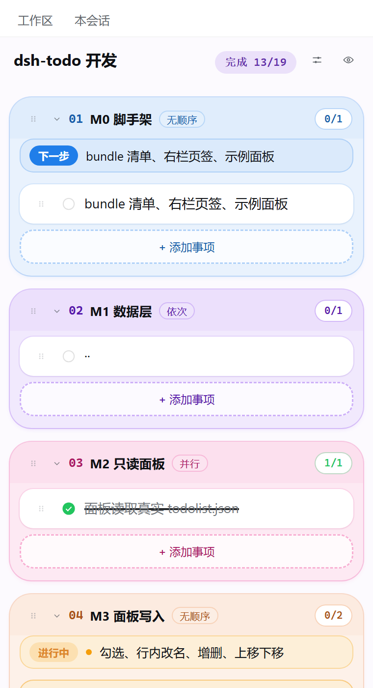
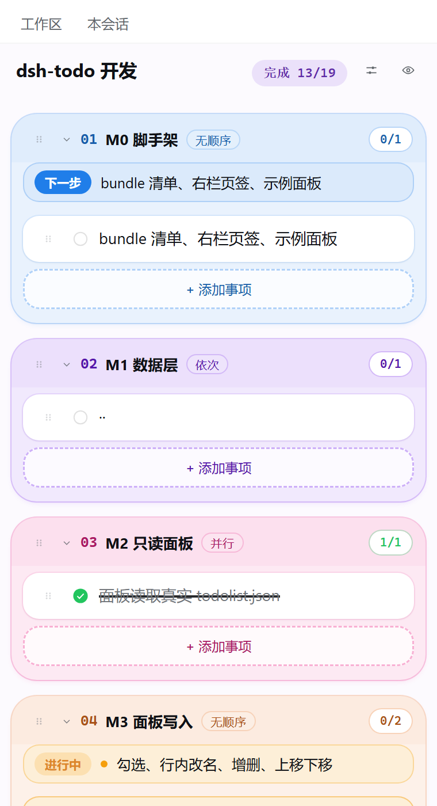
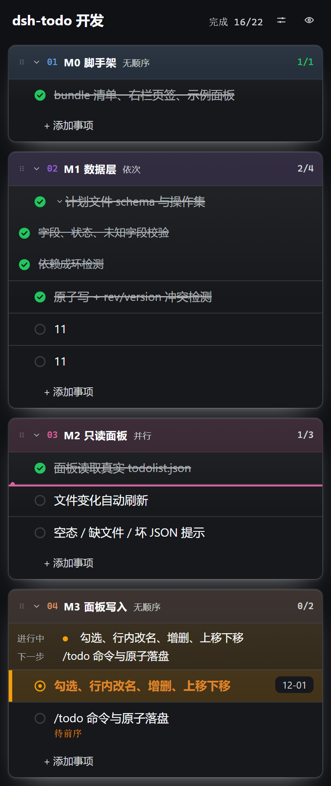
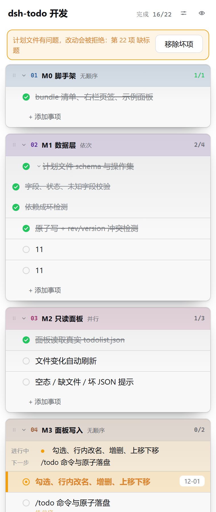
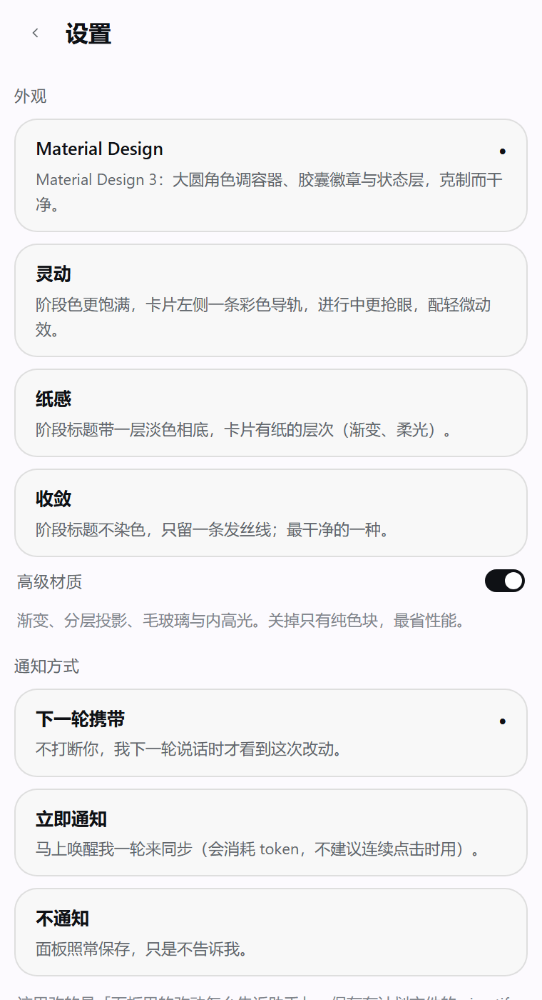

# dsh-todo

给 [DeepSeek Harness](https://github.com/deepseek-ai/deepseek-harness)（DSH）用的项目计划面板：右栏一个页签，按阶段跟踪跨会话的待办、先后依赖和截止日期。

**它更像一块你和助手共用的白板，而不是一个任务管理器。** 面板不排期、不催你、也不会自己开工——它只是放在右栏的一块记事板：你把「做到哪、下一步做什么」写上去，助手把它的进度写上去，于是你们看的是同一块板。

面板上有**两个页签，两块板**：

- **工作区**：跟着工作区走，同一个工作区的会话共用（数据就是工作区的 `todolist.json`，能进 git）；
- **本会话**：跟着这个对话走，换工作区也还在（数据在 DSH 的用户数据目录里）。

两块可以同时存在、同时用；哪块不存在就在那个页签里点「新建」，**只打开开关不会建任何东西**。

两块可以同时存在、同时用；哪块不存在就在那个页签里点「新建」，**只打开开关不会建任何东西**。

 



## 为什么要另外做一个

DSH 自带的待办面板在输入框上方，属于当前会话，结构是扁平的一条一条。做需要好几天、跨几个会话的项目时不够用：

- 需要**阶段**，阶段之间有顺序，也能并行；
- 需要**子事项**，父项只看汇总；
- 需要**先后依赖**（这件事没做完，那件事先等着）；
- 需要**截止日期**，而且只显示你给的，不替你估算工时；
- 你**在面板里直接改**，助手立刻知道；**助手在对话里改**，你也立刻看到。

## 分工：面板管「做完没有」，助手管「正在做什么」

这是这个插件最重要的一条设计，避免两个控件抢同一件事：

| 谁 | 能改什么 |
|---|---|
| 你（面板） | 完成 / 未完成（点左侧圆点）；加事项、改名、删除、拖动排序、设截止日期 |
| 助手（`todolist` 工具） | 标「进行中」（**可以多项并行**）、设「下一步」（单指针）、其余全部写入 |

面板只做一件事：勾完成。想让某件事变成「进行中」或「下一步」，跟助手说一句就行——你说的话它本来就在听。

## 功能

- **两块板、两个页签**：`工作区`（同一工作区共用，进 git）和 `本会话`（跟着对话走）。两块都在时页签常驻，点一下就换；空的页签里直接给「新建」按钮。两个都没有时是一张卡片：还没有任务板。
- **阶段卡片**：每阶段一个色相，标题下常显「进行中 / 下一步」；可折叠；可整块拖动排序。
- **子事项**：父行左侧三角折叠，折叠后显示 `+N`；折叠状态记在本地，刷新后保持。
- **拖拽排序**：只从行左侧的六点抓手开始拖，落到某一行画插入线、落到空白处画「追加到末尾」；松手后面板底部出现确认条，6 秒不点自动撤回；确认后其它行会平滑让位，而不是瞬间跳过去。

  

- **截止日期**：只在你填的时候显示；逾期/今天用颜色区分；再点一次即清除。
- **隐藏已完成**：顶部眼睛图标切换。
- **坏文件自救**：计划文件里有一行不合法（手改常见）时，面板会指出是哪一行并给「移除坏项」按钮，而不是整个面板点了没反应。

  

- **通知助手**：面板里的改动按三档告诉助手——`下一轮携带`（默认，不打断）、`立即唤醒`（马上开一轮来同步）、`不通知`。连续改动会在窗口期内合并成一条，窗口默认 8 秒，可在设置页改。
- **四种外观**：`Material Design`（`md3`，**默认**：Material 3 的色调容器 + 胶囊徽章 + 大圆角行卡片）、`灵动`（彩色标题栏 + 4px 导轨 + 同色描边）、`纸感`（阶段标题带淡色相底，卡片有纸的层次）、`收敛`（不染色，只留一条发丝线）。高级材质（渐变、分层投影、毛玻璃）有独立开关，关掉更省性能。

  

- **动效**：勾选完成时圆环弹出、勾线画出来、删除线跟着「划」过去，整行泛一层成功色；阶段与子项折叠是双向高度动画；拖动时被拖的行变淡缩小；删除时行左移淡出并收起。系统开启「减少动态效果」时全部关闭。

  

- **「进行中」用琥珀色统一标记**：左侧 4px 竖条、状态圆环、20% 琥珀底色、琥珀色标题；阶段色相只负责阶段标识，跨阶段一眼能看出哪件在做。

## 安装

要求：DSH Desktop（0.2.2-rc.5 上验证）；本插件只在右栏工作，不影响输入框以外的其它界面。

1. 拿到仓库：`git clone https://github.com/GUGUQ1/dsh-todo.git`
2. 在 DSH 里：**插件 → 添加插件 → 选择这个目录**（或让助手执行 `plugin_manager install_bundle`，目标填仓库绝对路径）。
3. 刷新页面（Desktop 里 `Ctrl+R`）。

装好后：右栏「开始」页会多一张 **项目计划** 卡片，输入框上方也会多一个「计划」胶囊，点任意一个都能打开面板。

细节（三种安装方式、回滚、权限）见 [docs/INSTALL.md](docs/INSTALL.md)。

## 使用

面板里的操作都是即时的，不需要「保存」。

**每个会话有一个开关**（输入框上方「计划」胶囊右边），默认关闭：打开后这个会话的助手才知道计划面板存在、能用 `todolist` 工具；关着的时候工具会被拒绝、改动也不通知它。开关**只管用不用**——打开它不会创建任何板。面板本身随时可以打开查看和编辑。


关于「进行中 / 下一步」，直接跟助手说：

```text
把 X 设为下一步
Y 和 Z 我同时在推，标进行中
这三条做完了
```

助手会调 `todolist` 工具写进计划文件；你自己勾完成时，助手也会收到通知（按设置的三档）。子对话（一次性会话）没有开关，一律视为关闭，需要改计划时会把结论回报给主对话。

完整用法见 [docs/USAGE.md](docs/USAGE.md)，常见问题见 [docs/FAQ.md](docs/FAQ.md)。

## 数据放哪

| 板 | 位置 | 跟着谁 |
|---|---|---|
| 工作区公板 | 工作区里的 `todolist.json`（先找根目录，找不到再在工作区里找层级最浅的同名文件） | 工作区（能进 git、能 diff） |
| 本会话私板 | `$DSH_HOME/dsh-todo/<会话id>/private.json`（默认 `~/.dsh/…`） | 这个对话（换工作区也还在） |

- 写入是**原子**的：临时文件 + rename，`rev` 每次 +1，写前比对文件大小与修改时间，冲突就拒绝而不是覆盖。
- 面板不写文件，每个操作都走宿主命令 `/todo op <json>`；宿主校验通过才落盘。私板的路径只由会话 id 推导，不接受任何外部路径。
- 别的会话的私板**只读**：助手可以带着 `board: "session:<id>"` 看一眼，改不了；你要直接看就切到那个会话。
- 格式与操作列表见 [SPEC.md](SPEC.md)。

## 兼容性

| 项 | 说明 |
|---|---|
| DSH | 0.2.2-rc.5（Desktop，Windows）已验证；只用公开的插件 API |
| 依赖的宿主服务 | `commands`（必需）、`tools`、`skills`、`workingDirectory`（后三者缺失时会降级，面板与命令不受影响） |
| 平台 | 面板是纯浏览器代码；宿主端只用 `node:` 内置模块，理论上跨平台，Linux/macOS 未实测 |

## 权限与隐私

- **不联网**：插件自身不发任何网络请求。
- **读文件**：用 DSH 的只读文件 Remote（工作区文件服务对单个文件的读取本来就不限于工作区，私板正好用它）。
- **写入范围**：只有两处——会话工作区内的 `todolist.json`，和 `$DSH_HOME/dsh-todo/` 下由插件自己算出来的那一个私板文件。任何传入路径都不会决定私板位置。
- **注入内容**：面板改动会作为一条用户消息注入会话（形如「用户在工作区公板上把「X」标成了 completed」），不写任何自定义事件类型。

细节见 [SECURITY.md](SECURITY.md) 与 [docs/PRIVACY.md](docs/PRIVACY.md)。

## 已知限制

- 子事项只能有「标题 / 状态」，不支持截止日期、备注、再嵌套（v1 格式）；
- 私板在 DSH 的用户数据目录里，不跟着项目备份，也不会进 git（想带走就复制到工作区）；
- 阶段计数只统计顶层事项，子项不计入分母；
- 同一时刻只有一个「下一步」（但「进行中」可以多项）；
- 面板里不能自己标「进行中」，这是故意的分工（见上）；
- **Linux / macOS 上的 DSH 没有实测过**：面板是纯浏览器代码、宿主只用 `node:` 内置模块，理论上没问题，但目前只在 Windows 11 + DSH 0.2.2-rc.5 上验证过。

## 文档

| 文件 | 内容 |
|---|---|
| [docs/INSTALL.md](docs/INSTALL.md) | 安装、升级、卸载、回滚 |
| [docs/USAGE.md](docs/USAGE.md) | 面板怎么用、两个页签、通知三档、快捷键 |
| [docs/DETAIL.md](docs/DETAIL.md) | 一段话介绍 + 快速上手（列表/详情页用） |
| [docs/FAQ.md](docs/FAQ.md) | 「点了没反应」「助手看不见工具」等 |
| [docs/AGENT.md](docs/AGENT.md) | 给助手看的使用说明（插件也会把它注册成一个技能） |
| [SPEC.md](SPEC.md) | 文件格式与操作列表 |
| [docs/ARCHITECTURE.md](docs/ARCHITECTURE.md) | 代码结构、数据流、为什么这么分 |
| [docs/COMPAT.md](docs/COMPAT.md) | 已验证的版本与依赖 |
| [DECISIONS.md](DECISIONS.md) | 每个非显然取舍的记录 |
| [DESIGN.md](DESIGN.md) | 视觉与排版规则 |
| [CONTRIBUTING.md](CONTRIBUTING.md) | 怎么改、怎么跑测试 |
| [CHANGELOG.md](CHANGELOG.md) | 版本变更 |
| [DEVLOG.md](DEVLOG.md) | 逐轮开发日志 |

English: [README.en.md](README.en.md)。

## 开发

```bash
node tools/plan-store-test.mjs   # 文件格式 / 操作 / 原子写（无依赖）
node tools/board-test.mjs        # 两块板：路径规则、页签默认、跨会话只读
node tools/command-test.mjs      # 宿主命令与通知
node tools/tool-test.mjs         # 模型工具
node tools/smoke-client.mjs      # 面板渲染冒烟
```

五套都是纯 Node，不需要 DSH 在跑。安装到 DSH 做页面验证的步骤见 [CONTRIBUTING.md](CONTRIBUTING.md)。

## 许可

[MIT](LICENSE) © 2026 GUGUQ1
