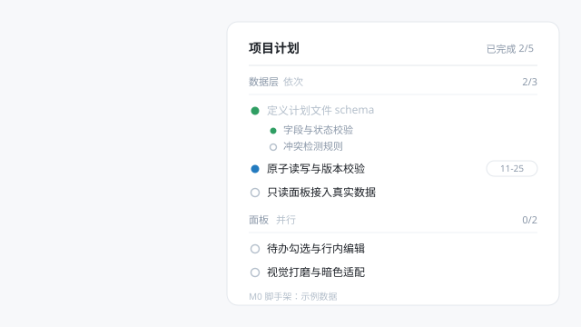

右栏里的项目计划面板：按阶段跟踪跨会话的待办、先后依赖和截止日期，你和助手各自都能改。

## 它解决什么

DSH 自带的待办在输入框上方、属于当前会话、结构是扁平的。做跨几天的项目时需要阶段、子事项、前后依赖和截止日期，也需要「你在面板里改」与「助手在对话里改」同时成立。

## 怎么打开

- 右栏「开始」页 → **项目计划** 卡片；
- 输入框上方的「计划」胶囊；
- 对助手说「打开计划面板」。

## 分工

- **面板**只改一件事：完成 / 未完成（点左侧圆点）；另外能加事项、改名、删除、拖动排序、设截止日期。
- **助手**负责「进行中」（可多项并行）与「下一步」（单指针），通过 `todolist` 工具写入。

想让某件事变成进行中或下一步，跟助手说一句即可。

## 数据

工作区里的 `todolist.json`（先找根目录，再找层级最浅的同名文件）。写入是原子的，`rev` 每次 +1，写前比对文件大小与修改时间，冲突就拒绝而不是覆盖。面板不直接写文件，所有操作都走宿主命令 `/todo op <json>`。

格式与操作列表见仓库的 `SPEC.md`。

## 通知

面板改动按三档告诉助手：下一轮携带（默认）、立即唤醒、不通知；窗口内的连续改动合并成一条（默认 8 秒，可调）。

## 已知限制

- 子事项只有标题与状态（无截止日期、备注、嵌套）；
- 阶段计数只统计顶层事项；
- 「下一步」只有一个，但「进行中」可以多项；
- 面板不能自己标「进行中」——这是刻意的分工。

## 更多

安装与回滚：docs/INSTALL.md · 用法：docs/USAGE.md · 常见问题：docs/FAQ.md · 完整说明：README.md

## 会话开关

输入框上方的「计划」胶囊旁边有一个开关，**按会话生效、默认关闭**：打开后助手才会拿到说明并使用 `todolist` 工具，面板改动也会通知它；关着时工具拒绝、通知静默，但面板仍可打开查看。子对话没有开关，需要改计划时回报主对话。
