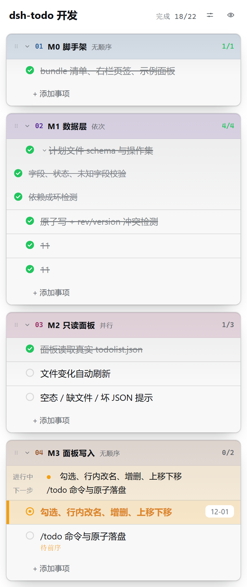

# 常见问题

## 打开开关后，面板说「还没有任务板」

这是对的：**开关只管用不用，不建任何东西**。面板上有两个页签 `工作区` / `本会话`，两侧都没有板时显示一张卡片，点「新建公板」或「新建私板」就行；也可以让助手建（`todolist create board=private`）。

## 两块板有什么区别，助手会改哪块

| 页签 | 跟着谁 | 存在哪 | 适合放什么 |
|---|---|---|---|
| **工作区** | 工作区 | 工作区里的 `todolist.json` | 这个项目的事（同一工作区的会话共用，能进 git） |
| **本会话** | 这个对话 | `$DSH_HOME/dsh-todo/<会话id>/private.json` | 只跟这次对话有关的事，或换工作区也想带着的事 |

助手默认改**你正看着的那块**（面板会把当前页签告诉它）。两块都在、你又没说明，它会问一句。

## 私板换工作区还在吗 / 会进 git 吗

在：私板的路径只跟会话 id 有关，换工作区（甚至换项目目录）还是同一块。不进 git：它存在 DSH 的用户数据目录里（默认 `~/.dsh/dsh-todo/`），跟会话数据一起备份。想让它进项目就复制一份到工作区。

## 能看别的会话的私板吗

助手可以**只读**（`board: "session:<会话id>"`）；它不能改、也不能替那个会话建。你想直接看就切到那个会话去——面板不列别人的板。

## 面板顶部黄条说「本会话没有启用计划面板」

这是**每个会话独立的开关**（输入框上方「计划」胶囊右边），默认关闭。

- 关着的时候：助手拿不到说明、`todolist` 调用被拒、面板改动也不通知它；面板本身仍可打开、仍可编辑。
- 点一下开关打开，下一轮立即生效。

新会话默认关，是为了不在不相干的对话里注入计划相关的内容。

## 助手说「本会话没有启用计划面板」

同上：请打开输入框上方的开关。如果它说「这是子对话」，那是对的——子对话没有开关，也不能读写计划；让它把结论回报给主对话。

## 点了没反应（勾不动、删不掉、拖了不生效）

先看面板顶部有没有一条黄色提示：**「计划文件有问题，改动会被拒绝：第 N 项 …」**。

写入校验的是**整份文件**，所以文件里只要有一行不合法（最常见是手工编辑时漏了 `title`），所有写入都会被整体拒绝。

- 点提示右边的 **移除坏项**，宿主会把那几行删掉、写回，之后一切正常；
- 或者让助手把那一行补好；
- 如果提示说 JSON 语法坏了，那是文本问题，自动修不了，得手工改。

没有黄色提示时，看面板底部的 `rev`：点一次成功能不能 +1？不能的话把面板里的红条文字发我。

## 助手看不见 `todolist` 工具

查 `%TEMP%\dsh-todo-tool-status.json`：

```json
{"tool":{"ok":true,"name":"todolist","parameters":18,"at":"…"}}
```

- 文件不存在 / 没有 `tool` 键 → 宿主还没跑到注册那一步；
- `"ok":false` → 看 `error` 字段；
- `"deferred":true` → `tools` 服务当时没就绪，注册在等它（正常情况会很快补上；一直这样就是宿主没起来）。

再确认两件事：宿主代码改动后有没有**重启 DSH**（不是只刷新页面）；`/todo` 命令在不在（`/` 里搜一下）——命令在而工具不在，说明只有工具那条链路出了问题。

## 面板显示的不是我以为的那份文件

看页脚：公板是 `文件 <相对路径> · rev <N>`，私板是 `本会话私板 · rev <N>`（悬停看绝对路径）。公板的解析顺序是「工作区根目录 → 工作区里层级最浅的同名文件」，两份时浅的赢。

工作区是**会话创建时的目录**，不是当前仓库目录。想换文件：把它放到更浅的位置，或新建一个会话在它的目录里打开。私板不用担心这个——它只有一处。

## 改完提示 `stale`（文件已变化）

你在读之后有人（助手、编辑器、git）改过这个文件。面板会自动重读，重试一次即可。这是防止「旧数据覆盖新数据」的保护。

## 通知太吵 / 不想让助手知道

设置页（右上角滑块 → 通知方式）：

- 改成 `不通知`：面板照常保存，只是不告诉助手；
- 或把**合并窗口**调大（默认 8 秒），连续点击会合成一条。

## 拖不动

只有行左侧的六点抓手（悬停出现）能拖，行本身拖不动——这是为了不抢圆点的点击。阶段同理，抓手在阶段标题最左边。

## 能不能在面板里标「进行中」

不能，这是设计决定：面板只负责「完成 / 未完成」，进行中和下一步由助手维护（给它说一句就行）。原因见 [README](../README.md#分工面板管做完没有助手管正在做什么) 与 [DECISIONS ADR-0010](../DECISIONS.md)。

## 能不能同时有好几个「下一步」

不能，只有一个指针。但「进行中」可以有多件——并行推进时让助手把它们都标成进行中。

## 子事项为什么不能设截止日期

v1 格式里子项只有 `id` / `title` / `status`，是为了让结构简单、校验明确。需要更细就把它升成顶层事项。

## 隐藏已完成之后，某个阶段说「这个阶段的 N 项都已完成」

那是正常的：该阶段的事项还在，只是都被你标成完成、又被「隐藏已完成」挡住了。面板会明说数量，而不是假装这个阶段是空的。


## 阶段进度为什么不是 100%

阶段计数只统计**顶层事项**，子项不在分母里。这样「父项做完、子项还有没做的」不会让计数看起来永远差一点。

## 数据能进 git 吗

公板能。`todolist.json` 是普通 JSON，适合版本管理。注意它是**共享状态**（助手也会写），冲突时按普通文本合并，别让两边同时大改。私板不进 git（在工作区外）。

## 卸载后数据会没吗

不会。两块板都留在原地：公板在你的工作区里，私板在 `$DSH_HOME/dsh-todo/` 里；卸载插件只影响面板与工具。

## 面板空白 / 加载不出来

- 刷新页面（`Ctrl+R`）；
- 右侧面板是在浏览器里渲染的，控制台（`Ctrl+Shift+I`）里若有报错，把第一行发我；
- 确认插件在插件页里是**启用**状态。

## 面板看着很平，没有层次/光影



两种原因：

1. **高级材质被关掉了**。设置页最上面的「高级材质」开关关掉后，卡片、拖动确认条都会退回纯色块（这是给性能敏感场景留的）。打开它就有渐变、分层投影、毛玻璃和内高光。
2. **用的是浅色主题**。DSH 浅色主题里 `bg-base` 与 `bg-layer-1/2` 是同一个白色，所以面板的层次不靠底色差，而靠卡片自带的墨色调和描边——深色主题下投影会变成高光，看起来更明显，这是正常的。

## 勾选、折叠、删除都没有动效

先看设置页的「高级材质」有没有关（关掉不影响动效），再确认系统设置里的「减少动态效果 / Reduce motion」。插件遵守 `prefers-reduced-motion: reduce`，开启时所有动画都会关闭——这是有意的，不是 bug。

## 我的计划文件写着 paper，所以面板还是纸感

默认外观是 **Material Design（`md3`）**，但默认值只对**没有显式写过** `ui.style` 的计划生效。老文件里如果写了 `"style": "paper"`，面板会尊重文件里的值。想让这份计划用新默认：设置页点一下「Material Design」（会把 `ui.style` 改成 `md3`），或者让助手执行 `todolist settings style=md3`。

## 保存位置与格式

公板：工作区里的 `todolist.json`；私板：`$DSH_HOME/dsh-todo/<会话id>/private.json`。两块格式完全一样，见 [SPEC.md](../SPEC.md)；`ui.style` / `ui.material` / 通知设置存在各自文件里，只影响观感与通知，不影响事项数据。
