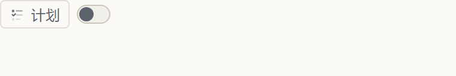
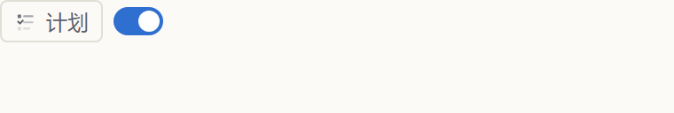
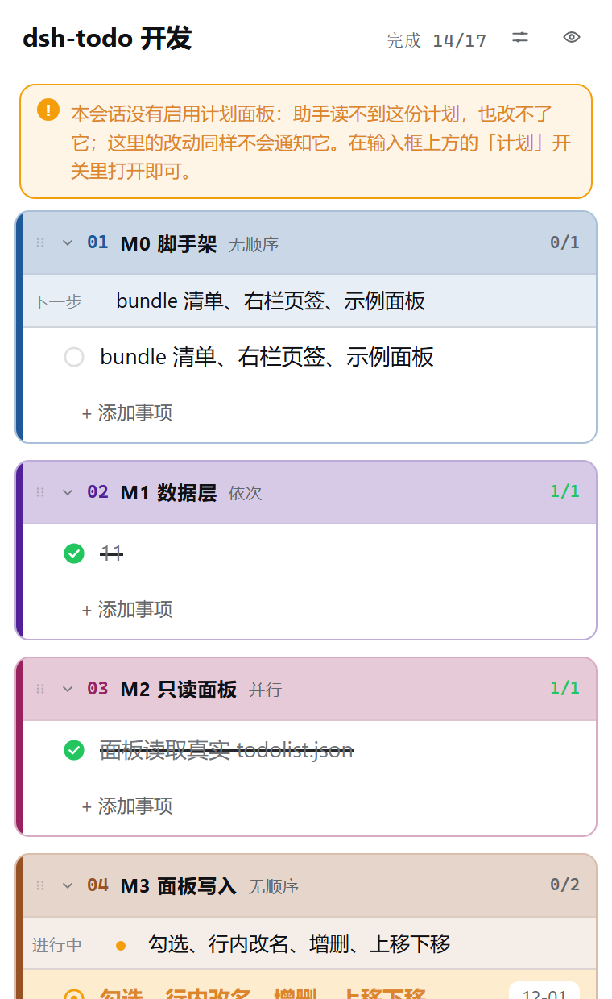
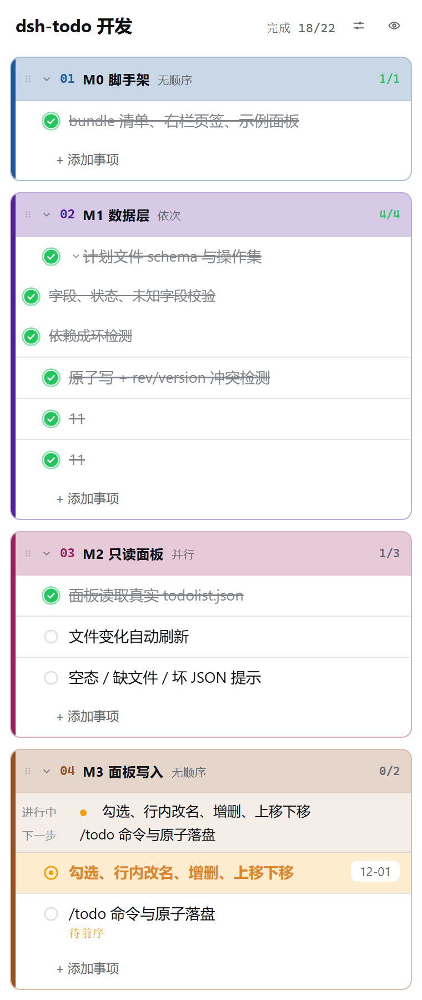
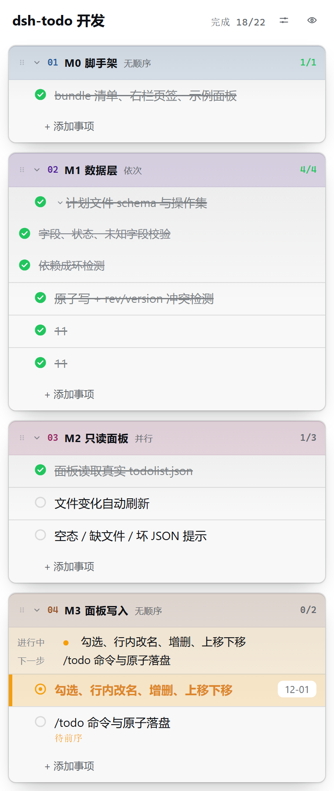
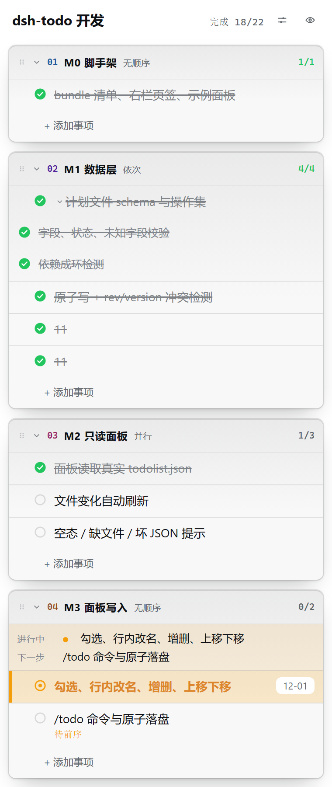
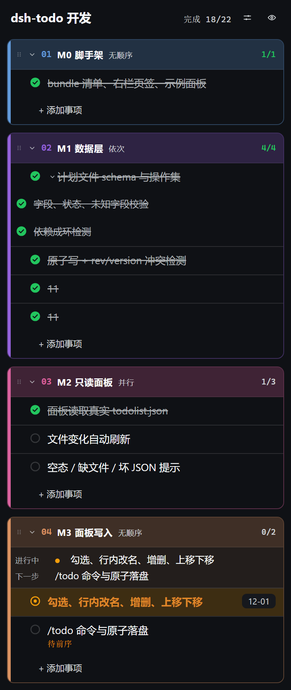

# 使用说明

## 打开面板

三种方式，效果一样：

1. 右栏「开始」页 → **项目计划** 卡片；
2. 输入框上方的「计划」胶囊；
3. 让助手调用 `todolist` 的 `open` 动作（例如你说「打开计划面板」），面板会自己跳出来。

## 会话开关（要不要用这个插件）

输入框上方是「计划」胶囊 + 一个小开关：

 

- **点胶囊**：打开右栏面板（随时可以看）。
- **点开关**：
  - **开** → 这个会话的助手会得到一段说明（本会话启用了计划面板、分工与用法），并且**可以**用 `todolist` 工具读写计划；你在面板里的改动也会通知它。
  - **关**（默认）→ 不给助手任何关于计划的注入，`todolist` 调用会被拒绝，面板改动也不通知。面板本身仍可打开查看，顶部会有黄色提示。



状态按会话记在本地，切换立刻生效（下一轮就按新状态来）。关掉后不会删除任何已注入过的历史内容——只是之后的轮次不再带。

> 子对话（助手派出去的一次性会话）没有开关，一律视为关闭：它要把改动回报给主对话。

## 面板结构

```
┌ dsh-todo 开发            完成 14/20  ⚙  👁 ┐   标题栏：计划名、顶层完成数、设置、隐藏已完成
│ ┌ 01  M0 脚手架  无顺序            1/1 ┐ │   阶段卡片：编号、标题、模式、顶层完成数
│ │ 进行中 ● …            （有进行中时）  │ │   标题下常显：进行中 / 下一步
│ │ 下一步   …                          │ │
│ │ ○ 这条还没开始                      │ │   行：圆点、标题、待前序、截止、行尾按钮
│ │ ⌄ 父事项  +3（折叠时）              │ │   含子项的行左侧有折叠三角
│ │   ○ 子事项                          │ │
│ │ + 添加事项                          │ │
│ └─────────────────────────────────────┘ │
│ + 添加阶段                               │
│ 文件 dsh-todo/todolist.json · rev 149    │   页脚：实际读到的文件与版本号
└──────────────────────────────────────────┘
```

- **圆点**：未完成 ↔ 已完成。进行中的行是强调色底 + 加粗，点一下就是「完成」。
- **行尾按钮**：悬停或键盘聚焦时出现——`[截止日期] [设日期] [加子项] [删除]`。不悬停时它们不占宽度，标题用满整行（窄面板下也不会出现"右边空白、文字却截断"）；有日期时标签本身可点，点一下清除。
- **待前序**：`after` 里还有未完成的项时才显示，且只在未开始的行上显示。
- **阶段模式**：`依次` / `并行` / `无顺序`，只是标签，排序仍由拖拽决定。

## 关于「进行中 / 下一步」

面板**不能**自己标进行中，这是刻意的分工：

| 你想表达 | 怎么做 |
|---|---|
| 这件事做完了 | 点左侧圆点 |
| 我正在做这件事 | 跟助手说「把 X 标成进行中」 |
| 接下来做这件 | 跟助手说「把 X 设为下一步」 |

- 「进行中」可以有多件（并行）；「下一步」只有一个。
- 标成「下一步」不会自动把别的项取消，但完成的项不能再设为下一步。
- 一个事项完成或删除时，如果它正是「下一步」，指针自动清空。
- 阶段标题下的那一行：有进行中就显示「进行中 · 第一件（+N）」，另有不同的下一步时再显示一行；同一件事不会出现两次。

## 拖拽排序

- 只能从**行左侧的六点抓手**开始拖（悬停出现），行本身不可拖——这样点圆点不会被拖拽手势吃掉。
- 拖到某一行上：那行上/下出现一条 2px 插入线（左端有小圆点）。
- 拖到阶段空白处：最后一行下方出现一条线，表示追加到这个阶段末尾。
- 可以拖进另一个阶段；阶段标题上的抓手可以把整个阶段拖走。
- 松手后面板**底部固定条**出现「把「A」移到「B」之后」，`确认` 才写文件，`取消` 或 6 秒不管就撤回。

## 子事项

- 父行标题前有三角时说明它含子项；折叠后显示 `+N`。
- 折叠状态记在浏览器本地（按计划文件路径），刷新后保持。
- 子项只有标题和状态：没有截止日期、备注，也不能再嵌套。

## 截止日期

- 行尾日历图标 → 出现日期选择器。
- 有日期时显示为标签：逾期（红）、今天（黄）、未来（灰底）。
- 点标签清除日期。
- 插件**不会**替你估算完成时间，只显示你填的日期。

## 设置（右上角滑块图标）

- **通知方式**：
  - `下一轮携带`（默认）——不打断你，助手下一轮说话时才看到这次改动；
  - `立即唤醒`——马上唤醒助手一轮来同步（会消耗 token，连续点击时不适合）；
  - `不通知`——面板照常保存，只是不告诉助手。
- **合并窗口**：窗口内的连续改动合成一条通知，默认 8 秒，范围 1–600 秒。

设置是**显示/行为偏好**，存在计划文件的 `ui` 里，跟着文件走。

## 键盘

- 行可以聚焦（Tab）：`Enter` / `空格` 切换完成，`F2` 改名，`Delete` 删除。
- 行尾按钮出现与否跟随键盘聚焦（`:focus-visible`），所以不用鼠标也能操作。
- 设置页与空态的按钮都是普通 `<button>`，可用 Tab + Enter。

## 数据在哪

页脚那行就是答案：`文件 <相对路径> · rev <N>`。

- 优先读工作区根目录的 `todolist.json`；没有就搜索工作区，取层级最浅的同名文件。
- 想让它读另一个文件：把那份放到更浅的位置，或在对话里让我调整。

### 外观

- **风格**：`灵动`（**默认**：彩色标题栏 + 卡片左侧 4px 导轨 + 同色描边，进行中更抢眼）/ `纸感`（阶段标题带淡色相底，卡片有纸的层次）/ `收敛`（阶段标题不染色，只留发丝线）。
- **高级材质**：渐变、分层投影、毛玻璃、内高光。默认开；对性能敏感可以关掉，面板会变成纯色块。

两者都存在计划文件的 `ui.style` / `ui.material` 里，跟着文件走；只影响观感，不影响数据。

| 灵动（默认） | 纸感 | 收敛 |
|---|---|---|
|  |  |  |

深色主题下同一套规则会把投影变成高光，所以看起来更「发光」：



### 动效

| 动作 | 看到的 |
|---|---|
| 勾选完成 | 圆环弹出 → 勾线画出来 → 删除线从左划到右，整行泛一层成功色并淡出 |
| 折叠 / 展开阶段或子项 | 内容高度双向动画（0.24s），收起时里面的按钮不会被 Tab 到 |
| 拖动排序 | 被拖的行变淡并轻微缩小；落位后其它行用 FLIP 平滑让位（0.22s），不会瞬间跳过去 |
| 删除 | 行左移、淡出并收起高度，落盘后才真正消失 |

动画只在**真实状态变化**时播放：换序、进出设置页不会重放。系统开启「减少动态效果」（`prefers-reduced-motion: reduce`）时全部关闭。

### 进行中的颜色

「进行中」统一用**琥珀色**（`state-warn-primary`）而不是阶段色：行左侧 **4px** 竖条、状态圆环、**20%** 琥珀底色、琥珀色标题、阶段提示条的小圆点。阶段色相只用于阶段标识，这样跨阶段一眼就能看出哪件在做。
